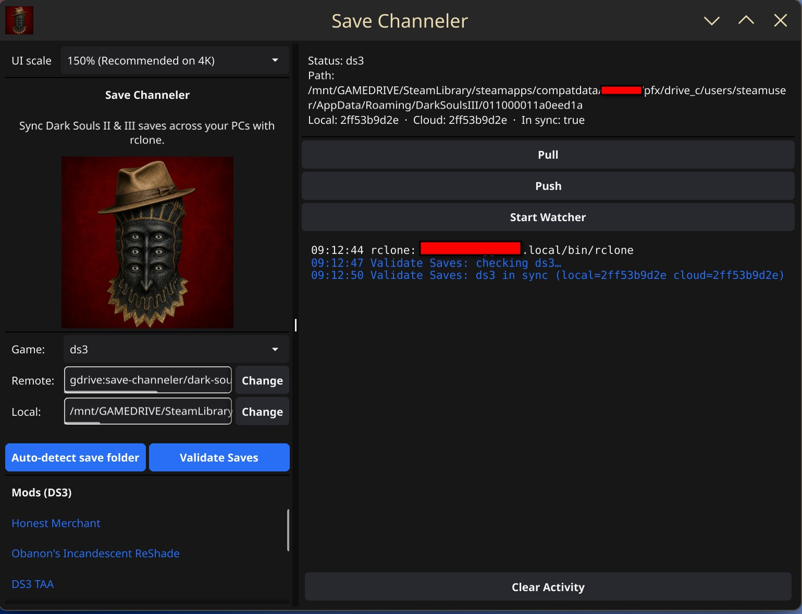

# Save Channeler



Open-source cloud saves for **DARK SOULS II** and **DARK SOULS III** on Steam — **Windows, Linux, and Steam Deck**.

CLI binary: **`save-channeler`**.

macOS is a fine place to **develop and cross-compile**, but not a runtime target: DS2/DS3 do not ship native Mac Steam builds, so save sync belongs on the machines where you actually play.

FromSoftware never shipped Steam Cloud for these titles. Save Channeler fills that gap **without** embedding cloud API secrets and **without** running a sync server that sees your saves.

## Security model

- **Your cloud, your credentials.** Sync uses an [rclone](https://rclone.org/) remote *you* configure (**Google Drive** or **Proton Drive**). Packaged builds ship rclone next to the app; Save Channeler only shells out to that binary (or a path you set).
- **No embedded OAuth client secrets** in this repo or binary.
- **No central sync server.** We never receive your save files.
- **No silent overwrites.** Divergent local/remote saves produce a conflict; you choose local or remote. Local snapshots are kept before replace.
- **No save-folder symlinks into cloud storage.** That pattern has corrupted Souls saves when the provider locks files mid-write.
- **No telemetry.**

Threat note: whoever can use your rclone remote can read/write the dedicated folder you pointed at. Use a folder that exists only for Save Channeler.

**Google vs Proton auth:** Google Drive opens a browser OAuth page. Proton Drive signs in with email/password (and optional 2FA) in the app — no browser approve step — then creates your sync folder. Log into [drive.proton.me](https://drive.proton.me) in a browser at least once beforehand so encryption keys exist; refresh that page if the new folder does not appear immediately.

## How it works

1. **`play`** — pull → launch via `steam://rungameid/...` → wait for exit → push  
2. **`watch`** — background watcher with debounce; pushes only after a quiet period **and** only when the game process is not running; idle pulls on an interval  
3. **`gui`** — Fyne desktop UI (DS3-inspired theme): status, pull/push/play, watcher, conflicts, mods list, and updates  

App icon (Channeler helm + beige fedora) lives in [`assets/icon.png`](assets/icon.png) and is embedded in GUI builds.

## Install (packaged — recommended)

Release zips/tarballs **include rclone**. You do **not** need to install rclone or put it on your PATH.

### Windows

1. Download `save-channeler-windows-amd64.zip` from [Releases](https://github.com/migzeetigglez/ashen-sync/releases).
2. Extract somewhere permanent (e.g. `%USERPROFILE%\Games\SaveChanneler`).
3. Double-click `save-channeler.exe`.
4. In the app: **Remote → Set** → choose **Google Drive** or **Proton Drive**, then pick a game and Auto-detect (or Browse).

`rclone.exe` sits next to `save-channeler.exe` in the same folder.

### Linux / Steam Deck

```bash
tar xzf save-channeler-linux-amd64.tar.gz
cd save-channeler-linux-amd64
./install.sh          # installs app + bundled rclone to ~/.local/bin + .desktop launcher
```

Open **Save Channeler** from the app menu (or `save-channeler gui`), then **Remote → Set** and choose a game.

### First-run setup

| Step | What happens |
|---|---|
| **Remote → Set** | Choose **Google Drive** (browser sign-in) or **Proton Drive** (email / password / optional 2FA). Sync folder defaults to `save-channeler`. |
| **Choose a game** | Pick DS2 SotFS, DS2, or DS3 — the app no longer silently defaults to one title. |
| **Local folder** | Auto-detect or Browse. On Deck/Linux this is usually under Steam Proton `compatdata`. |

**Remote → Change** can switch destinations or disconnect (cloud files are not deleted).

### Updates (Windows / Linux)

Packaged installs can self-update from [GitHub Releases](https://github.com/migzeetigglez/ashen-sync/releases):

- In the GUI, a top **Update available** banner appears when a newer release exists (**Update** installs it; **✕** dismisses with a short animation).
- Or run `save-channeler update` / `save-channeler update --check`.
- After updating, a **What’s new** dialog shows the GitHub release notes.

Release assets must keep stable names: `save-channeler-windows-amd64.zip` and `save-channeler-linux-amd64.tar.gz`. macOS builds only open the Releases page (no in-app replace).

## Build from source

Requirements: Go 1.22+, Steam + DS2 SotFS and/or DS3. rclone is optional if you package with the scripts below (they download a pinned rclone).

```bash
./scripts/package-linux.sh      # → dist/save-channeler-linux-amd64.tar.gz (+ rclone)
./scripts/package-windows.sh    # → dist/save-channeler-windows-amd64.zip (+ rclone.exe)
./scripts/package-macos.sh      # → dist/Save Channeler.app (dev machine)
```

Pin rclone with `RCLONE_VERSION=1.75.0` (default in scripts / CI). Tagged package builds stamp `internal/version.Version` via ldflags.

Manual binary only:

```bash
git clone https://github.com/migzeetigglez/ashen-sync.git
cd ashen-sync
go build -o save-channeler ./cmd/save-channeler   # GUI needs CGO + OpenGL on that OS
```

If you build without packaging, either place `rclone` next to the binary or install rclone and/or set `rclone_path` in config.

## Usage

```bash
./save-channeler games
./save-channeler status ds3
./save-channeler pull ds3
./save-channeler push ds3
./save-channeler play ds3
./save-channeler watch
./save-channeler gui
./save-channeler update          # Windows / Linux packaged installs
./save-channeler update --check
./save-channeler doctor
./save-channeler version
```

Conflict resolution:

```bash
./save-channeler pull ds3 --prefer remote
./save-channeler push ds3 --prefer local
```

Games: `ds2` (Scholar of the First Sin), `ds3`, `ds2-vanilla`.

### Steam Deck

1. Desktop Mode: install the Linux package (`./install.sh`).
2. Open the GUI once: **Remote → Set** (Google or Proton Drive), choose a game, Auto-detect.
3. For Game Mode, add a non-Steam shortcut or launch option:
   `/home/deck/.local/bin/save-channeler play ds3`
4. Optional: run `save-channeler watch` from Desktop Mode / autostart for idle sync.

### Config

- Linux/macOS: `~/.config/save-channeler/config.toml`
- Windows: `%APPDATA%\save-channeler\config.toml`
- Snapshots: `~/.local/share/save-channeler/snapshots/` (Windows: `%LOCALAPPDATA%\save-channeler\snapshots\`)

Legacy `~/.config/ashen-sync/` configs are still read if the new path is missing.

```toml
rclone_path = "rclone"         # optional override; packaged builds resolve bundled rclone automatically
remote = "gdrive"              # or "proton" for Proton Drive
remote_path = "save-channeler"
snapshot_keep = 10
quiet_period_seconds = 15
pull_interval_seconds = 300
ui_scale = 1.5                 # GUI scale (1.0–3.0); also changeable in the app
```

Override a save path if auto-detect fails:

```toml
[game_overrides]
ds3 = "/full/path/to/DarkSoulsIII/7656119..."
```

### Mods (GUI)

For the selected game (DS2, DS2 SotFS, or DS3), the left panel **Mods** section lists:

- Mods detected from the game install (when possible), and  
- Optional entries from a `README.md` or `MODS.md` in that game’s save folder next to the `.sl2` file:

```markdown
# Mods

- [Mod Name](https://www.nexusmods.com/darksouls3/mods/…)
```

## Save locations

| Platform | DS2 / DS2 SotFS / DS3 |
|---|---|
| Windows | `%APPDATA%\DarkSoulsII\<steamid>\` / `%APPDATA%\DarkSoulsIII\<steamid>\` |
| Linux / Deck (Steam Proton) | Steam library `compatdata/<appid>/pfx/drive_c/users/steamuser/AppData/Roaming/...` |

AppIDs: SotFS `335300`, DS3 `374320`, vanilla DS2 `236430`.

## Why not Dropbox junctions?

Cloud clients often lock files while uploading. Dark Souls writes saves frequently; a lock mid-write can corrupt the slot. Save Channeler copies through a staging area via rclone and never mounts the live save directory as a cloud folder.

## License

MIT — see [LICENSE](LICENSE).
